# Halixon Solis Modbus Data Logger - Introducing the HAL-100

A data logger for the Solis Inverter that allows you to send data to Home Assistant via MQTT for realtime monitoring whilst keeping your existing data logger for remote configuration and SolisCloud.

See the [Wiki](https://github.com/bretmac/halixon-solis-modbus/wiki) and take part in the [Discussions](https://github.com/bretmac/halixon-solis-modbus/discussions).  Your feedback is appreciated.

## Why the HAL-100?

There are numerous Solis Data Logger projects out there, so why choose the HAL-100?

Here are a few key features to whet your appetite:

- It's a single board solution.  No fragile connections.  No masses of wires.  Plug in a data cable, a Micro USB Power Supply and that's it.  Really.

- The prototype PCB is tiny:
  

It has to grow a little larger, of course, in order to accomodate holes for mounting into an enclosure, for example.  However, the board pictured above is a fully functional prototype (*see Features and Roadmap) and can be used as-is.

- The HAL-100 aims to be simple to install, setup and configure.

- It is tested!  Development has had a strong focus on unit testing.

- It is low power.   The device only consumes around 1W of power.

- You choose the data polling interval.  Say goodbye to the SolisCloud **five minute** updates.  The prototype is sending sensor data every five **seconds**.

- Automatic Inverter time setting.  Never set your inverter time again!

- Seemlessly works with SolisCloud and Solis logger, if you wish.

- Sends JSON sensor data to Home Assistant via its MQTT Broker.

- Any potential Cloud security issues disappear - you can enjoy local telemety without exposing your system to the internet.

- Over-the-Air firmware updates.  No need to reflash with your computer.

- Configured from your phone or PC with a small built-in web page.  No app to install, and nothing is loaded from the internet.

## Setting up the HAL-100

On first power-up the HAL-100 has no Wi-Fi details, so it starts its own Wi-Fi network called `HAL100-<serial number>`.  Join it with the setup key supplied with the device, then open `http://192.168.4.1/` in a browser.

If you are using a phone:

- **Turn off mobile data while you set the device up.**  The HAL-100's setup network has no internet connection, so many phones quietly send web pages over mobile data instead and the setup page never loads.  Alternatively, when the phone warns that the network has no internet, choose "Stay connected" or "Use this network anyway".
- **Type the whole address, including `http://`.**  Some browsers try `https://` first, and the page then never loads.

The setup page asks for:

- your Wi-Fi network name and password
- automatic (DHCP) or a fixed IP address
- an administrator password, used to log in to the device later

Save, and the device restarts and joins your network.  To get back to the setup page later, for example after changing your Wi-Fi password or forgetting the administrator password, press the boot button within 10 seconds of powering the device on.  Your other settings are kept.

To start again from scratch, use "Restore factory defaults" on the setup page or on the settings page.  It erases every setting and the administrator password, and the device returns to first-boot setup.

## The web interface

Once the HAL-100 is on your network, browse to its IP address and log in with the administrator password.  The settings page works on phones and on desktop browsers.

  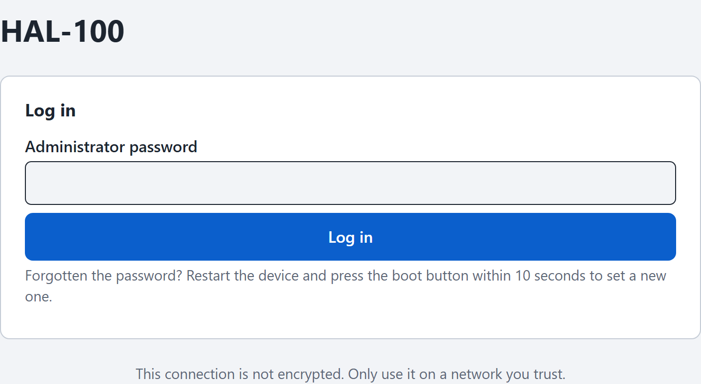
  &nbsp;
  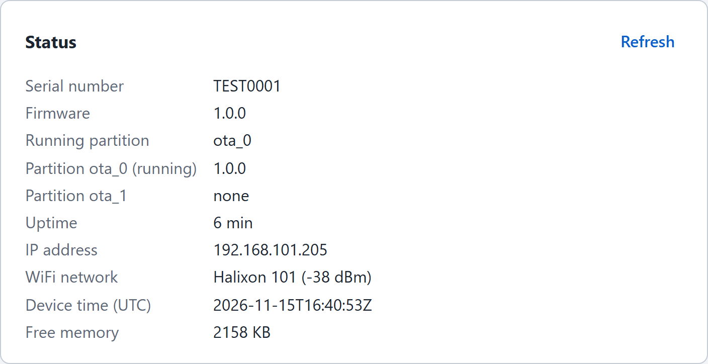

Everything that used to be hard-coded can now be set from the browser:

Panel | What you can set
---|---
Wi-Fi network | Network name and password
IP address | Host name, DHCP or a fixed IP address, subnet mask, gateway and DNS
Data logger serial port | Baud rate, parity and stop bits for the RS485 bus to your Solis data logger
Inverter serial port | Baud rate, parity and stop bits for the RS485 bus to the inverter
MQTT | Broker address, user name, password, quality of service and retain, plus the topics for the data logger capture and the diagnostics output
Time | Time server, time zone, and whether the HAL-100 keeps the inverter clock correct
Inverter polling | How often the inverter is read, and the MQTT topic for the readings
Modbus filter | Which inverter (Modbus server id) the data logger may talk to
Change administrator password | A new administrator password (the current one is needed)
Restore factory defaults | Erase every setting and return to first-boot setup.  You must type `RESET` and enter the administrator password first.

Saved passwords are never shown again; the page only says whether one is set.  Saving restarts the device so every change takes effect.  After five wrong passwords in a row, logins are refused for a while.

All the settings panels

  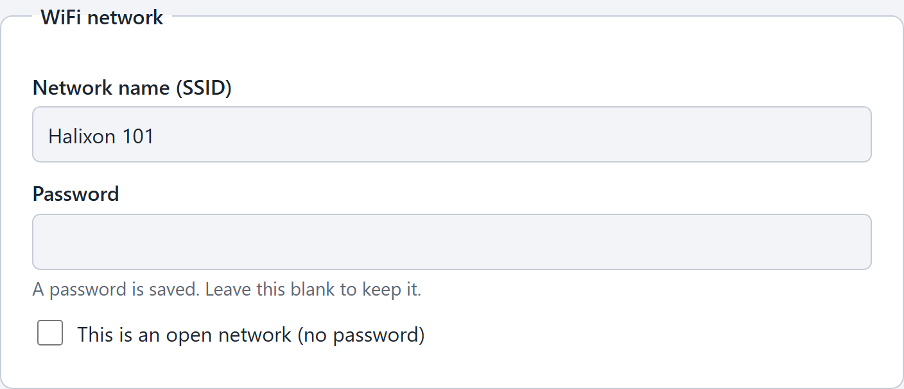
  &nbsp;
  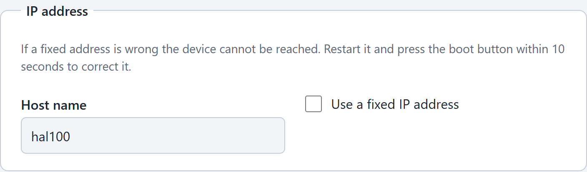

  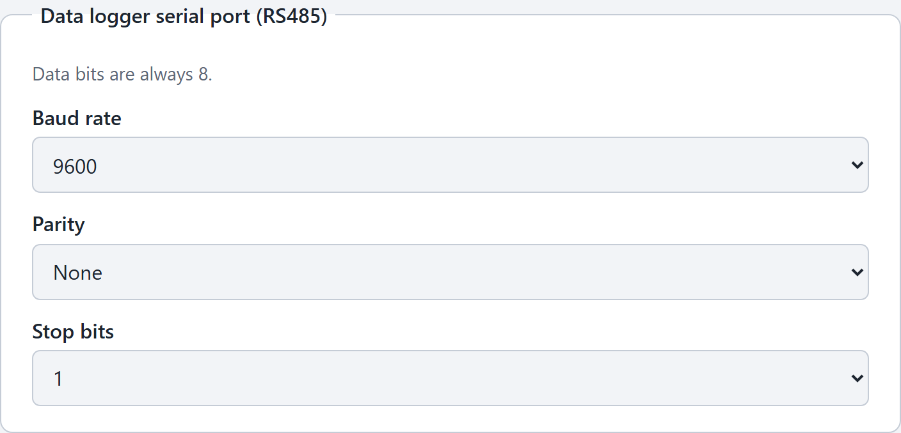
  &nbsp;
  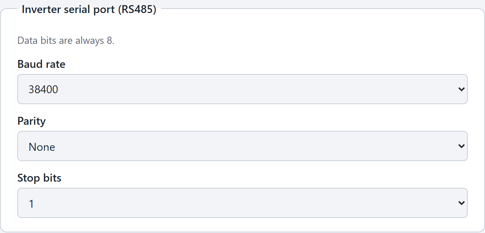

  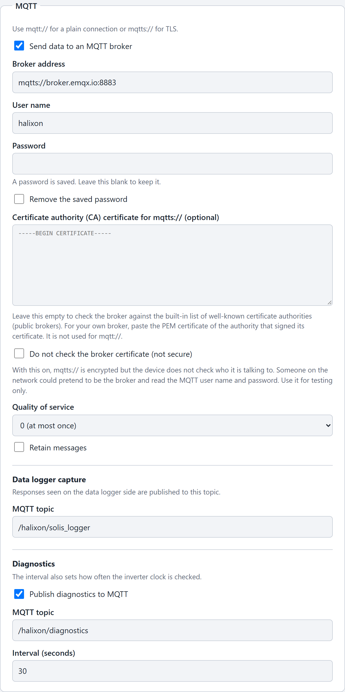
  &nbsp;
  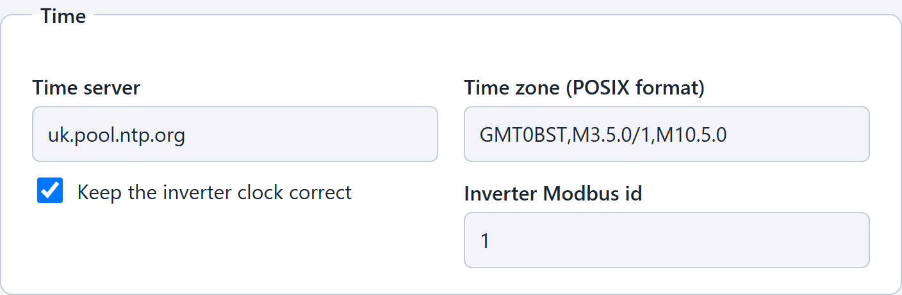

  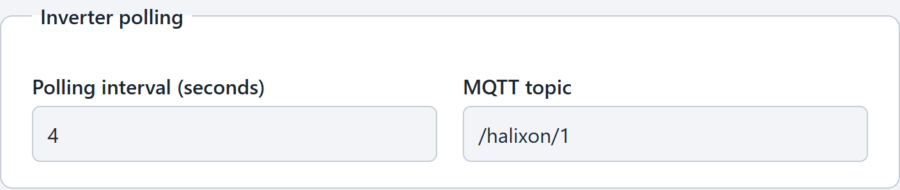
  &nbsp;
  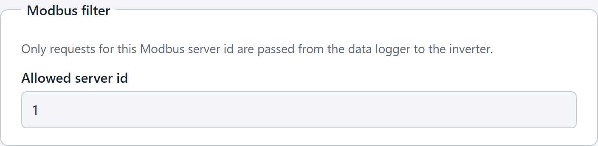

  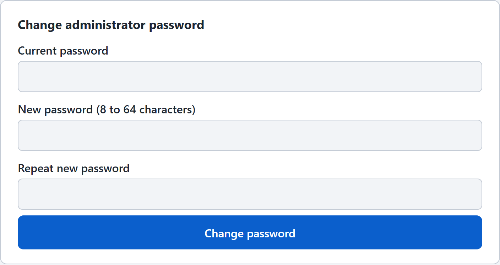
  &nbsp;
  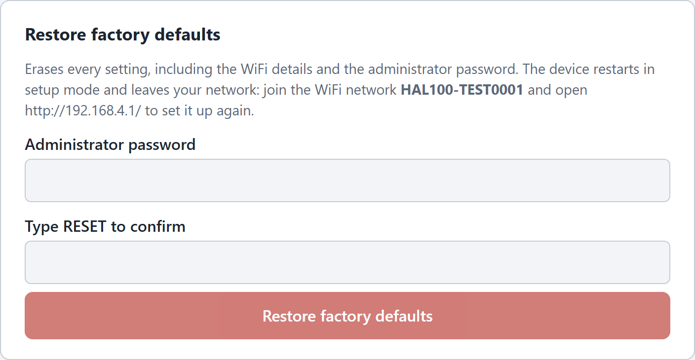

The whole page on a desktop browser and on a phone

  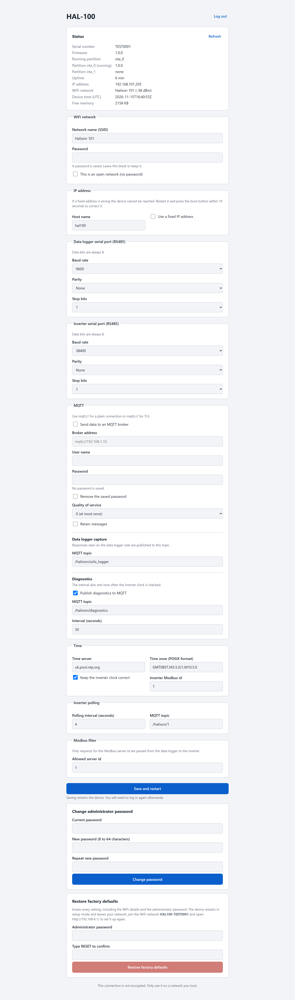
  &nbsp;
  

## Features and Roadmap

Feature|Description|Status
---|---|---
Configuration|A small, responsive web page built into the device, used from a phone or PC.  Log in with the administrator password to change any setting (see [The web interface](#the-web-interface)).  Plain HTML, CSS and JavaScript with no external dependencies.|Implemented and tested on a development board: login, saving settings, a fixed IP address, changing the password and the lockout after failed logins.  Required for V1.0
Initial Setup|On first boot, or when the boot button is pressed within 10 seconds of startup, the device starts its own Wi-Fi access point.  Connect with your phone or PC to enter the Wi-Fi details, a fixed IP address if you want one, and the administrator password.|Implemented and tested on a development board, including the boot button on an already configured device.  The serial number and setup key are still test values until factory programming is in place.  Required for V1.0
Restore Factory Defaults|A button on the setup page and on the settings page that erases all settings and returns the device to first-boot setup.  The button only works once `RESET` has been typed, and the settings page also asks for the administrator password.|Implemented and tested on a development board.  Required for V1.0
Modbus Client Interface|This interface allows a client to connect, via the Modbus Switch (see below), to send requests to the inverter.|Complete.  Baud rate, parity and stop bits are now configurable.
Modbus Server Interface|This interface connects to the inverter(s) to allow requests from the device itself, or from the Client Interface, to send requests to the inverter.|Complete.  Baud rate, parity and stop bits are now configurable.
Modbus Switch|The modbus switch allows multiple clients to access the server-side modbus.  This allows, for example, an S3 Wi-Fi stick to access the inverter and also the internal firmware to access the inverter.|Completed
Modbus Filter V1|The S3 data logger requires a lot of modbus time every five minutes as it scans for server IDs 1 thru 10.  This causes an unwanted blocking effect on the internal logger.  This component filters out invalid requests and requests for any server ID other than the configured one (1 by default).|Complete.  The allowed server ID is configurable, and a changed ID is picked up after the restart.  A later version will become a firewall between the data logger and the inverter, for example to block write commands.
Inverter Time Setter|The device synchronises its time from an internet time server.  Inverter time drift is checked and corrected as required.|90% Complete.  The time server and time zone are configurable, and time setting can be switched off.  Requires further logic to detect transition to and from Daylight Savings Time to correct the inverter's time straight away.
Sensor MQTT Output|The device consists of an internal logger that requests data from the inverter and produces a JSON output and publishes to an MQTT broker.|80% Complete  The broker, credentials, topic and polling interval are configurable.  Requires some further analysis to break out sensor groups into their own topics; for example many systems will not require three phase data, and not all systems have batteries.
Secure MQTT (TLS)|Connect to the MQTT broker over TLS (`mqtts://`), checking the broker against a CA certificate you supply.|In progress.  The certificate setting is still to be added.
Client Eavesdropper|This component allows any traffic from the client interface (e.g. A Solis logger) to be intercepted and sent as JSON via MQTT.  This has been very useful during development.  It can be used to create a dashboard containing the exact snapshots that the Solis logger see every five minutes.|Needs more work, but works very well in its current form.  The MQTT topic is configurable.  Each register range probably needs to be published to a unique topic.  Generic "start address", "register count", raw data, etc should be added.  This will be very useful for when end users start testing the device with their own inverters so the logger behaviour can be understood.
Diagnostics MQTT Output|The device produces lots of diagnostic data at a configurable interval (see dashboard below). The data is published as JSON to the MQTT broker.|Complete.  The topic and interval are configurable, and publishing can be switched off.
Over-the-Air Firmware Updates|The device retrieves new firmware versions from an internet server.  The status page shows which firmware slot is running and the version in each slot.|Proof of concept complete.  Required for V1.0
Signed Firmware and Encryption|Only firmware signed by Halixon can be installed (Secure Boot), and the firmware and stored settings are encrypted on the device.|Planned.  Required for V1.0
Secure Web Interface (HTTPS)|Serve the web interface over HTTPS.  Until then it uses plain HTTP, so only use it on a network you trust.|Planned for a later release
Multiple Inverters|Support several inverters on one bus, each with its own Modbus server ID.|Planned for a later release
MQTT Autodiscovery|Autoconfigure Sensors in Home Assistant|Planned for V2.0
Backup Wi-Fi|If Wi-Fi #1 fails connect to Wi-Fi #2|Planned for V2.0
Modbus TCP Server|Allow clients to send commands to the server bus via Modbus TCP|Needs some research.  This would be a great feature to allow inverter configuration.

## Some Home Assistant Dashboards

The logger itself has a rich set of diagnostics data:

